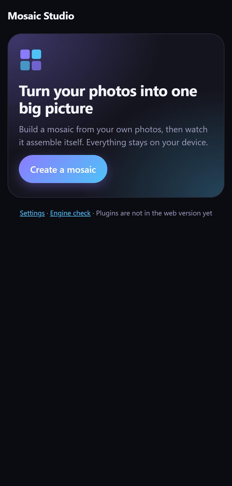
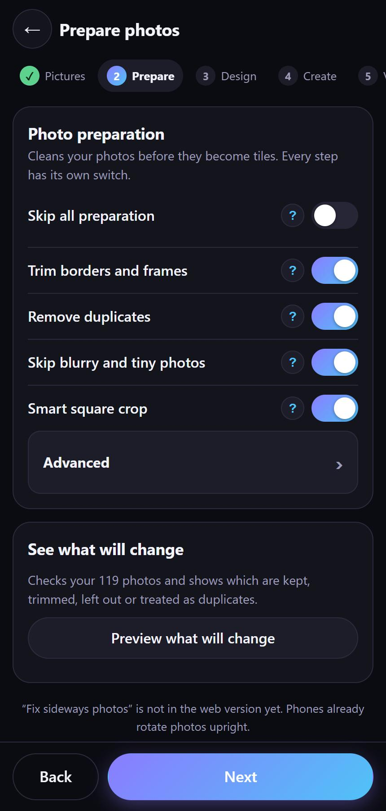
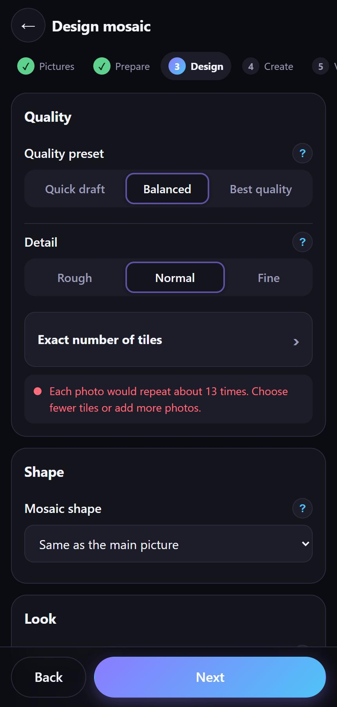
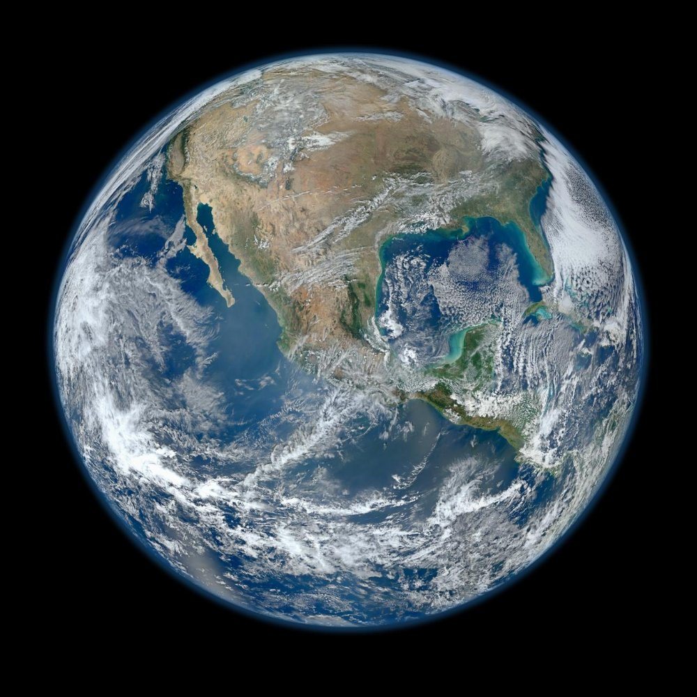
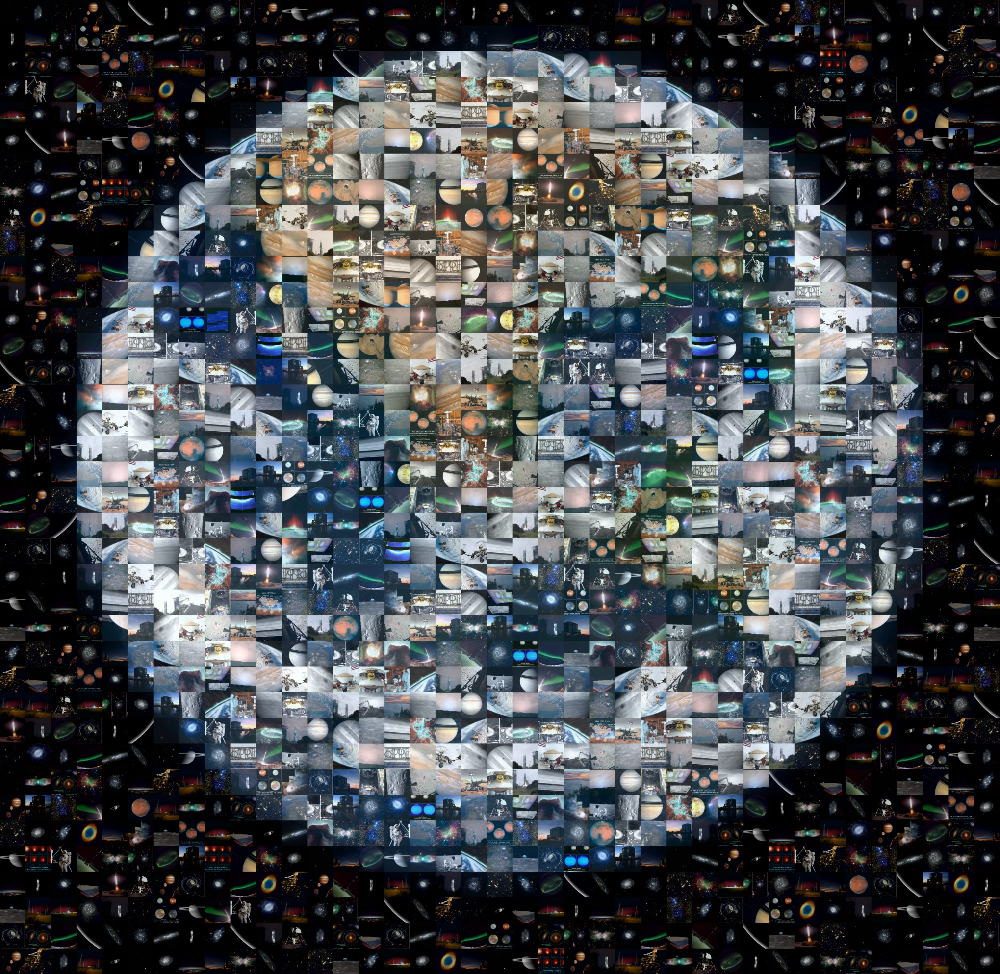
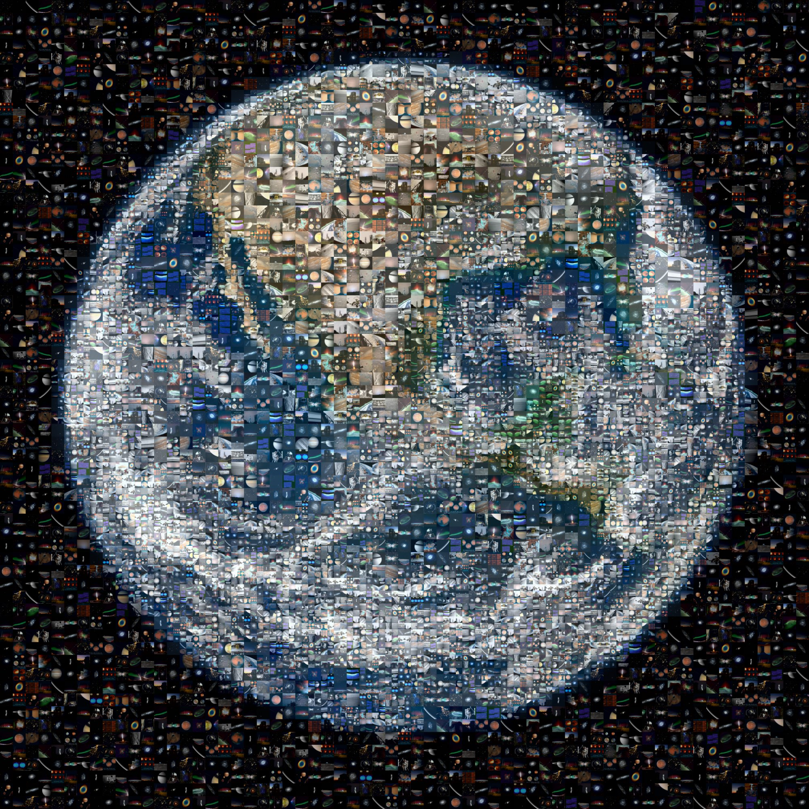
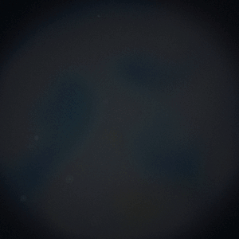
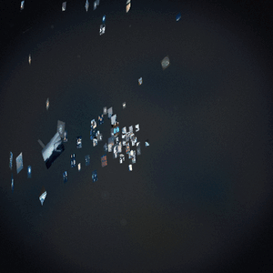
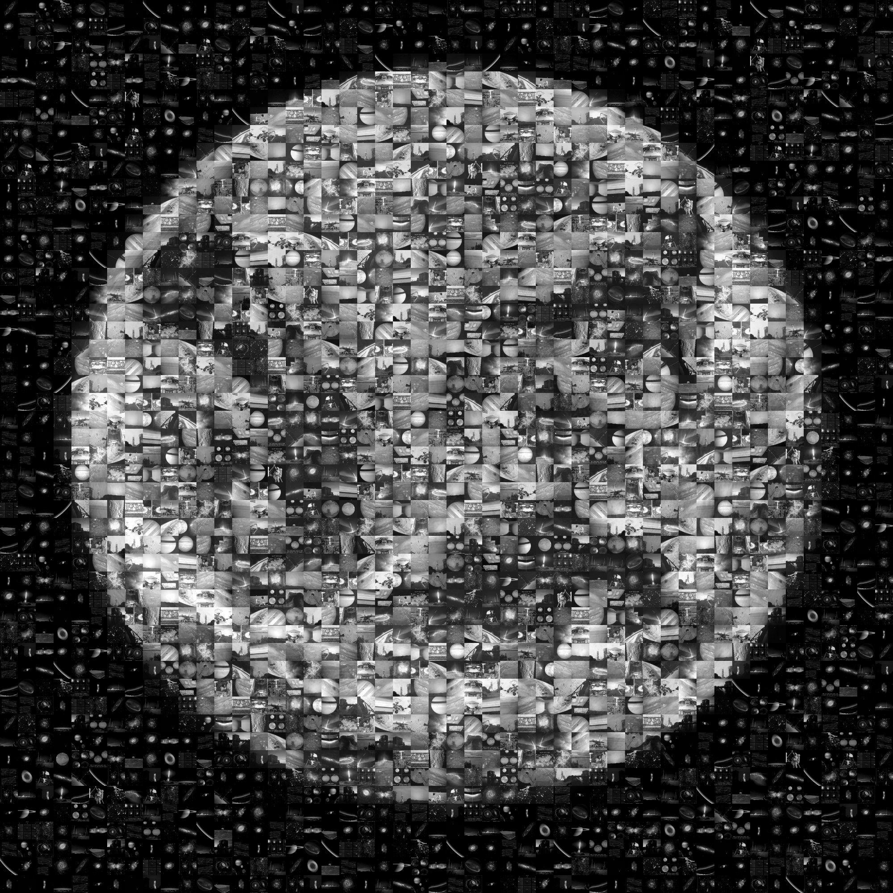

# Mosaic Studio Web

Turn a pile of photos into **one big picture made of tiny photos**, then watch it assemble itself as an animation.
It runs **in your browser, on your phone or your computer**, and your photos never leave your device. It installs like
an app (PWA), works offline once installed, and the heavy lifting is done by a **Rust** core compiled to
**WebAssembly**, with the animation drawn on the GPU (**WebGPU**, with a **WebGL2** fallback).

**Live app: <https://mahatosourav00.github.io/mosaic-studio-web/>**

<p align="center">
  
  
  
</p>

This is the web version of the Windows desktop app, [Mosaic Studio](https://github.com/mahatosourav00/mosaic-video).
It uses the same ideas (photo preparation, subject-aware matching, four animation styles) in a mobile-first interface.

## See it in action

**One main picture, three results.** All of these were made in the web app from the same 119 public-domain NASA photos
and NASA's *Blue Marble* picture of Earth. Only the settings differ.

<p align="center">
  
  
  
</p>

| | Main picture | Balanced preset | Fine detail |
|---|---|---|---|
| **Settings** | | Defaults: 1,500 tiles | 4,000 tiles, extra fine detail (small tiles) on, tint 0.7 |
| **Grid** | | 39 x 38 tiles | 63 x 63 tiles |
| **Output** | 1280 x 1280 px | 2496 x 2432 px | 4032 x 4032 px |

With only 119 photos, the *Balanced* result repeats each photo about 13 times and you can see the individual tiles.
*Fine detail* uses the same photos, but with far more (and smaller) tiles the planet's land, ocean and clouds come
through clearly. More photos (300+) always gives a richer, less repetitive mosaic.

**It assembles itself.** The same mosaic as an animation, in two of the four styles (*Swarm* on the left, *Vortex* on the right). These GIFs are small, low-colour previews; the app exports full-resolution MP4 video, far smoother.

<p align="center">
  
  
</p>

**Black and white.** Switch on *Black and white* and every tile is converted, so the picture is built from light and
shade alone (2,500 tiles, 3200 x 3200 px):

<p align="center">
  
</p>

<sub>Made with Mosaic Studio Web. Tiles: the [NASA Image and Video Library](https://images.nasa.gov/) (NASA media is
generally not copyrighted). Main picture: NASA's Blue Marble. The pictures above are JPEG copies scaled down to at most
2000 px wide; the app itself can produce much larger files.</sub>

## Use it

1. Open the [live app](https://mahatosourav00.github.io/mosaic-studio-web/) in a recent Chrome, Edge, Safari or Firefox.
2. Optional: tap **Install** (or your browser's *Add to Home screen* / *Install app*) to use it like a normal app,
   including offline.
3. Tap **Create a mosaic** and follow the five steps below.

There is nothing to sign up for and nothing is uploaded: photos are read on your device and the mosaic is built there.

## How it works: the five steps

A short guided flow with a progress bar: **Pictures → Prepare → Design → Create → Video** (the last step only appears if
you switch on *Also make an animation*).

| Step | What you do |
|---|---|
| **1. Pictures** | Choose the photos to use as tiles (individual photos, or a whole folder, with options to leave out folders or ignore sub-folders), and the one **main picture** the mosaic will imitate. You need at least 4 photos; 100+ is better and 300+ is plenty. |
| **2. Prepare** | Cleans your photos before they become tiles. Each step has its own switch: **trim borders and frames**, **remove duplicates**, **skip blurry and tiny photos**, **smart square crop** (face- and detail-aware), or **skip all preparation**. **Preview what will change** shows which photos are kept, trimmed, left out or treated as duplicates. |
| **3. Design** | Pick a **quality preset** (Quick draft 800 tiles, Balanced 1,500, Best quality 3,000) and **detail** (Rough / Normal / Fine) or an exact number of tiles. Live advice tells you how often each photo would repeat. Choose the **shape** (same as the picture, Story 9:16, Portrait 4:5, Square, Wide 16:9), the **tile shape** (square, wide or tall), **black and white**, gap colour, and the **output size** (screen, print size at 150 / 300 / 600 DPI, or exact pixels from Full HD up to 16K). **Preview mosaic** builds a fast draft first. |
| **4. Create** | Builds the finished picture and lets you save it as **PNG, JPEG or WebP**. For print sizes the DPI is stored inside the file. |
| **5. Video** | Optional. Choose an animation style and make a video (below). |

Every option has a **?** button that explains it in plain language and says what is recommended.

### Animation styles

The mosaic can assemble itself on screen in four styles, each with its own camera. The video page has a live preview.

| Style | Camera and motion |
|---|---|
| **Swarm** | Tiles swoop in from all sides while the camera orbits and sweeps across the picture. |
| **Vortex** | The camera circles the subject as the tiles spiral in. |
| **Wave** | A level sideways tracking shot follows a wave of tiles sweeping across the picture. |
| **Zoom** | Starts macro-close, then pulls straight back to reveal the whole picture. |

Each ends on a calm full frame. Tap **Make my video** to render it as **MP4** (H.264, using your browser's WebCodecs) or,
in browsers without MP4 support, a **WebM** recording made in real time. The video can have its own shape (Story, Portrait,
Square, Wide), length and quality, plus an optional blurred backdrop.

### Settings

Your options are remembered in the browser. A small **Settings** link at the bottom of the home screen lets you save
them to a `mosaic-settings.json` file, load them on another device, or reset to the defaults. Your photos are never
stored in the settings file.

## Status

The full flow works: Pictures → Prepare → Design → Create → Video, with all the options and "?" guides. Photo
preparation, the subject map, the solver, the still renderer and the animation all run in Rust/WebAssembly.

**Not in the web version yet:** plugins and the plugin library, "video from a saved mosaic", TIFF, H.265, GIF output,
"fix sideways photos" (phones already rotate photos upright), Web Workers for the solver and renderer (reading and preparing photos already runs in several workers at once), and real-device and
offline testing.

**Limits to know about:** very large photo sets and very large outputs are limited by your device's memory; the app
caps the output size and warns you. GPU texture arrays hold at most 256 layers, so tiles are paged.

## For developers

### Run it locally

Needs Rust (stable, with the `wasm32-unknown-unknown` target) and `wasm-bindgen-cli` 0.2.130.

```powershell
./build.ps1                      # cargo build -> wasm-bindgen -> ./pkg
python -m http.server 8765       # then open http://localhost:8765
cargo test -p mosaic-core --lib  # solver tests (native)
```

On Windows without Visual Studio Build Tools, `build.ps1` uses the GNU host toolchain with `rust-lld`
(`rustup toolchain install stable-x86_64-pc-windows-gnu -t wasm32-unknown-unknown`).

`pkg/` (the compiled WebAssembly) is generated and git-ignored, so a plain checkout needs the build step first.

### Project layout

| Path | Role |
|---|---|
| `crates/mosaic-core/src/prep.rs` | photo preparation: border trim, blur/size filter, duplicates, smart crop, subject map |
| `crates/mosaic-core/src/solver.rs` | tile grid, matching and assignment (CPU) |
| `crates/mosaic-core/src/still.rs`, `render.rs` | the finished still picture |
| `crates/mosaic-core/src/animation.rs`, `gpu.rs`, `shaders/` | the four animation styles and the wgpu renderer (WebGPU, WebGL2 fallback) |
| `js/pages.js`, `js/video-page.js`, `js/ui.js`, `js/app.js` | the mobile-first interface and page flow |
| `js/mosaic.js`, `js/prep.js`, `js/prep-one.js`, `js/prep-worker.js`, `js/engine.js` | glue between the interface and the WebAssembly core |
| `js/video.js` | player and MP4 (WebCodecs) / WebM export |
| `js/settings.js`, `js/help.js` | every option in one object, and the "?" guide texts |
| `sw.js`, `manifest.webmanifest` | offline support and installability |
| `docs/images/` | the pictures used in this README |

### Deploying

- **GitHub Pages:** `.github/workflows/pages.yml` runs the tests, builds the WebAssembly in CI and publishes on every push
  to `main`.
- **Netlify:** `netlify.toml` runs `netlify-build.sh`, which installs the stable Rust toolchain, builds the core and
  assembles a `site/` folder to publish.

### Notes learned so far

- wgpu's GL (WebGL2) backend treats a 2D texture array whose layer count is a multiple of 6 as a cube map: `upload()` pads
  such arrays by one layer.
- The WebGL2 fallback needs uniform structs whose size is a multiple of 16 bytes; pad them in WGSL.
- Texture arrays are limited to 256 layers on both backends, so tiles are paged.
- GPU code is gated to `target_arch = "wasm32"` so the solver tests run natively.

## Credits and license

Developed by **Sourav**. MIT licensed, see [LICENSE](LICENSE); bundled third-party software is listed in
[THIRD_PARTY_NOTICES.md](THIRD_PARTY_NOTICES.md). The Windows desktop app lives in the
[`mosaic-video`](https://github.com/mahatosourav00/mosaic-video) repository.
