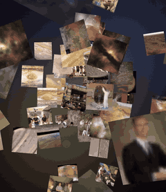
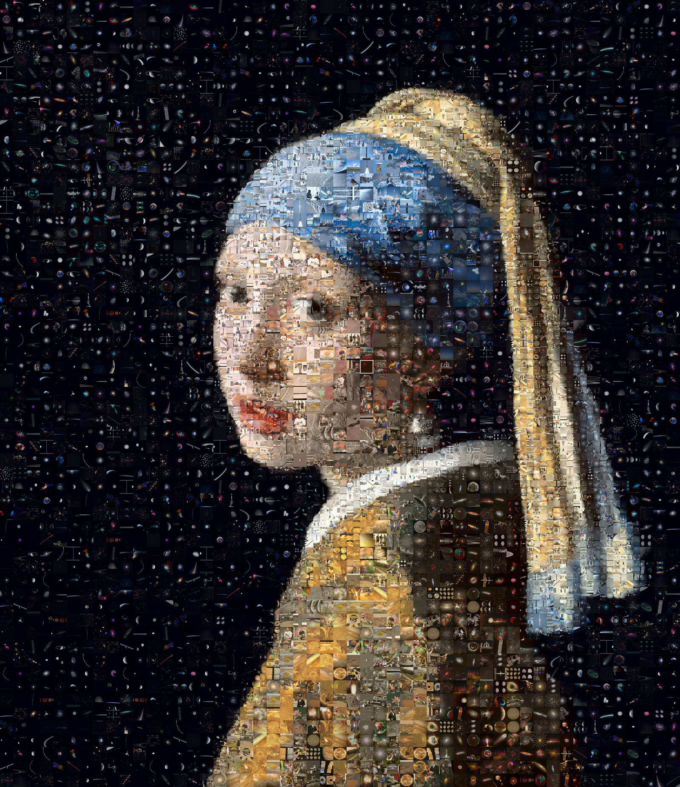
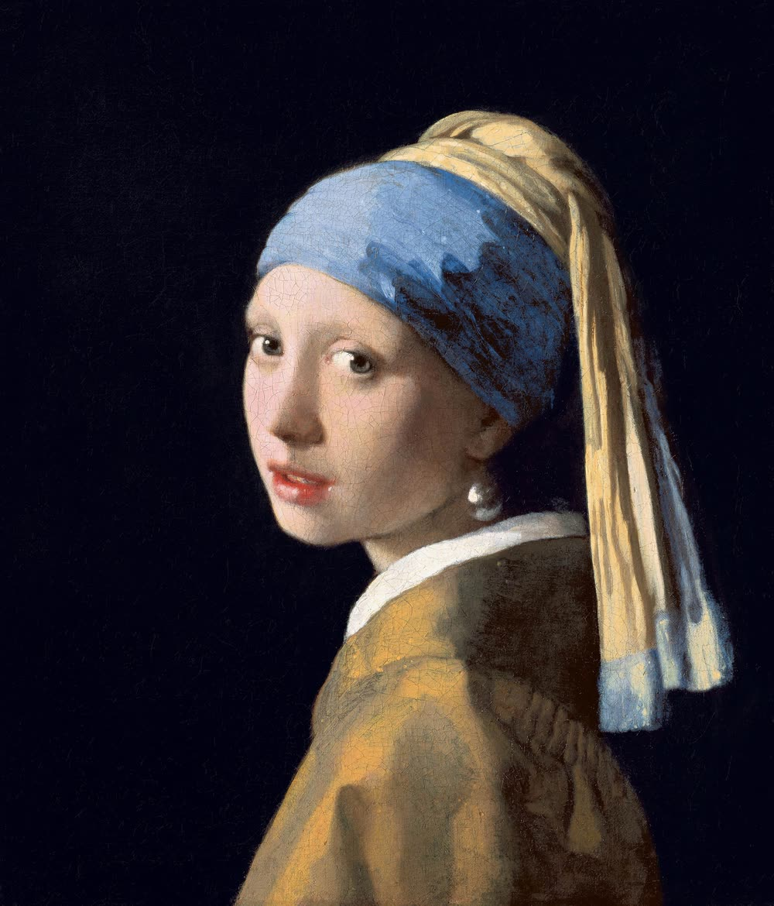
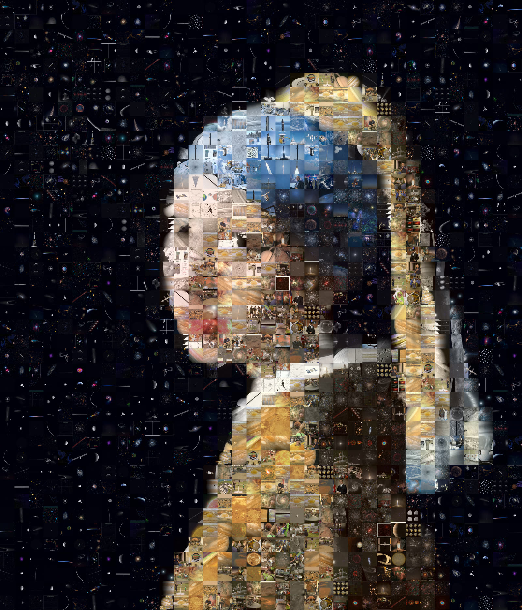
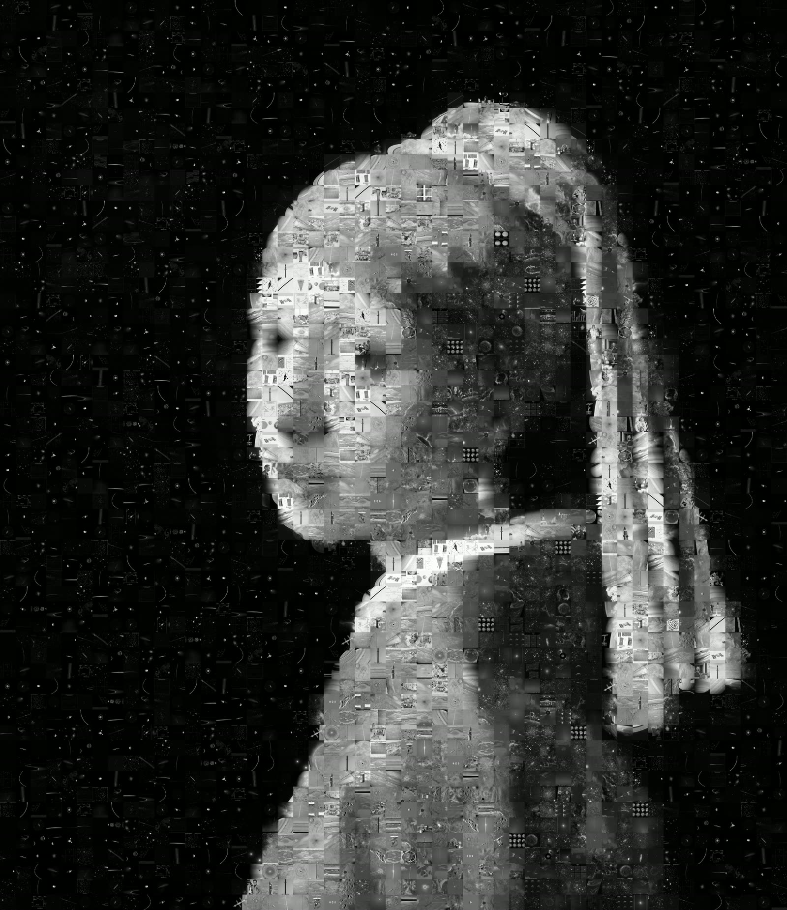
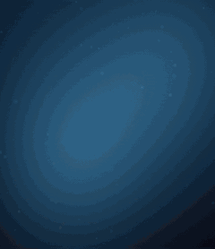

# Mosaic Studio Web

### Turn a pile of photos into one big picture made of tiny photos, then watch it build itself.

<p align="center">
  
  &nbsp;&nbsp;
  
</p>

<p align="center">
  <a href="https://mahatosourav00.github.io/mosaic-studio-web/"><b>▶ Try it now: mahatosourav00.github.io/mosaic-studio-web</b></a><br>
  <sub>Free · no sign-up · your photos never leave your device</sub>
</p>

It runs **in your browser, on your phone or your computer**, installs like an app, and works offline once installed.
This is the web version of the Windows app, [Mosaic Studio](https://github.com/mahatosourav00/mosaic-video).

---

## Make your first mosaic in 2 minutes

1. **Open the [live app](https://mahatosourav00.github.io/mosaic-studio-web/)** in Chrome, Edge, Safari or Firefox.
   *(Optional: tap **Install** or "Add to Home screen" to use it like a normal app.)*
2. Tap **Create a mosaic**.
3. **Pick your photos** (these become the tiny tiles) and **one main picture** (the big picture the mosaic will copy).
   You need at least 4 photos. 100+ is good, 300+ is great.
4. Tap **Next** through the steps. The defaults are good, so you can just keep going.
5. Tap **Make my mosaic**, then **save** it. Want the animation? Switch on *Also make an animation*.

<p align="center">
  
  
  
</p>

> **Tip:** every option has a **?** button that explains it in plain words and tells you what we recommend.

---

## What you can make

All the pictures below are made in the app from the same **1,285 public-domain NASA photos** and Vermeer's
*Girl with a Pearl Earring*. Only the settings differ.

### One picture, different settings

<p align="center">
  
  
  
  
</p>

| | Main picture | Balanced | Best quality + extra fine detail | Black and white |
|---|---|---|---|---|
| **Settings** | The painting you choose | Quality preset: *Balanced* | *Best quality*, with **Extra fine detail (small tiles)** on | *Best quality* with **Black and white** on |
| **Tiles** | | 36 x 42 (1,500) | 51 x 59 (about 3,000) plus small tiles | 51 x 59 (about 3,000) |
| **Output** | | 2304 x 2688 px | 4896 x 5664 px | 4896 x 5664 px |

*Balanced* is quick and the individual photos are easy to see. *Best quality* with *extra fine detail* uses far more, smaller
tiles, so the face, the turban and the pearl come through clearly. *Black and white* converts every tile, so the picture is
built from light and shade alone. More photos (300+) always gives a richer, less repetitive mosaic.

### It assembles itself

The same mosaic as an animation, made with two different **Looks** (ready-made bundles of settings). On the left,
**Falling tiles**: big showcase photos drift past, then tiles drop in from above, top to bottom, on a blue background. On
the right, **Fireworks**: tiles burst out of the middle with sparkle on a dark background. These GIFs are small previews; the app saves a
smooth, full-resolution **MP4**. All Looks and the four animation styles are described [below](#design-your-video).

<p align="center">
  
  &nbsp;&nbsp;
  
</p>

---

## The five steps

**Pictures → Prepare → Design → Create → Video** (the last step only appears if you switch on *Also make an animation*).

| Step | What it does |
|---|---|
| **1. Pictures** | Choose your tile photos (single photos or whole folders) and the main picture. |
| **2. Prepare** | Cleans your photos first: trims borders and frames, removes duplicates, skips blurry or tiny photos, and crops smartly around faces and detail. Each has its own switch. **Preview what will change** shows what is kept or left out. |
| **3. Design** | Pick a quality (**Quick draft**, **Balanced**, **Best**), how detailed it is, the shape (same as the picture, Story, Portrait, Square, Wide), black and white, and the output size (screen, print at 150 / 300 / 600 DPI, or Full HD up to 16K). **Preview mosaic** makes a quick draft. |
| **4. Create** | Builds the finished picture. Save it as **PNG, JPEG or WebP**. |
| **5. Video** | Design and save the animation (below). |

## Design your video

Pick a **Look** (a ready-made bundle of settings) and watch the live preview. Then fine-tune if you like.

- **Looks:** Default, Calm drift, Cinematic, Chaotic storm, Snappy reveal, Fireworks, Falling tiles, Bloom, Photo gallery,
  Spiral and Swipe, plus **Surprise me**. You can save your own.
- **Four styles:**

| Style | Camera and motion |
|---|---|
| **Swarm** | Tiles swoop in from all sides while the camera orbits and sweeps across. |
| **Vortex** | The camera circles the picture as the tiles spiral in. |
| **Wave** | A level sideways shot follows a wave of tiles sweeping across. |
| **Zoom** | Starts macro-close, then pulls straight back to reveal everything. |

- **Tile motion:** how far tiles fly in from, which direction, in what order, how fast, how they land, spin, sparkle and
  arrival waves. There are three quick presets: Gentle, Lively and Wild.
- **Camera:** pick a move (Orbit, Push in, Pull back, Sweep, Crane, Static) or draw your own with the camera editor, or
  tap **Surprise camera**.
- **Background:** glow from your photos, a solid colour or a gradient, with ready-made moods (Midnight, Sunset, Ocean,
  Forest and more).
- **Output:** length (8 to 40 s), shape, 360p to 4K, 30 or 60 fps. Saved as **MP4** (or **WebM** in browsers without MP4
  support). **Pin preview** keeps the preview on screen while you scroll.

## Your settings

Options are remembered in your browser. Every settings page has **Reset to defaults** (with **Undo**). On the home screen,
**Settings** lets you save everything to a `mosaic-settings.json` file and load it on another device. Your photos are never
stored in it.

## Good to know

- **Privacy:** nothing is uploaded. Photos are read and the mosaic is built on your device.
- **Memory:** very large photo sets or output sizes depend on your device's memory. The app caps the size and warns you.
- **Not in the web version yet:** plugins, "video from a saved mosaic", TIFF, H.265 and GIF export.

---

## For developers

The heavy lifting is a **Rust** core compiled to **WebAssembly**, with the animation drawn on the GPU (**WebGPU**, with a
**WebGL2** fallback).

**Run it locally.** Needs Rust (stable, with the `wasm32-unknown-unknown` target) and `wasm-bindgen-cli` 0.2.130.

```powershell
./build.ps1                      # cargo build -> wasm-bindgen -> ./pkg
python -m http.server 8765       # then open http://localhost:8765
cargo test -p mosaic-core --lib  # solver tests (native)
```

On Windows without Visual Studio Build Tools, `build.ps1` uses the GNU toolchain
(`rustup toolchain install stable-x86_64-pc-windows-gnu -t wasm32-unknown-unknown`). `pkg/` is generated and git-ignored.

**Layout**

| Path | Role |
|---|---|
| `crates/mosaic-core/` | Rust core: photo preparation, solver, still renderer, animation and wgpu renderer |
| `js/` | Interface and page flow, glue to the WebAssembly core, workers, video export |
| `sw.js`, `manifest.webmanifest` | Offline support and installability |
| `docs/images/` | Pictures used in this README |

**Deploying.** `.github/workflows/pages.yml` runs the tests, builds the WebAssembly and publishes to GitHub Pages on every
push to `main`.

## Credits and license

Developed by **Sourav**. MIT licensed, see [LICENSE](LICENSE); bundled third-party software is listed in
[THIRD_PARTY_NOTICES.md](THIRD_PARTY_NOTICES.md).

<sub>Sample tiles: the [NASA Image and Video Library](https://images.nasa.gov/) (NASA media is generally not copyrighted).
Main picture: Johannes Vermeer's *Girl with a Pearl Earring* (public domain). The pictures above are scaled-down copies;
the app can produce much larger files.</sub>
